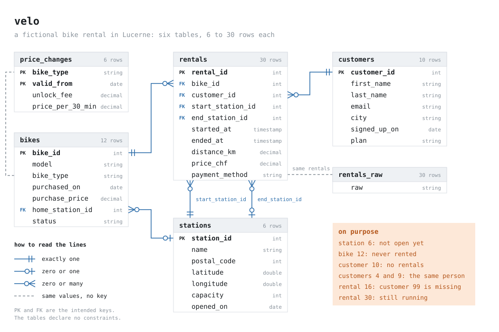
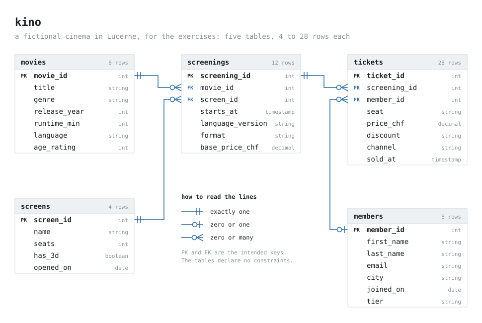

# Learn Databricks SQL

The code of the blog series **Learn Databricks SQL** on [stefanko.ch](https://www.stefanko.ch).

Every part of the series takes one piece of Databricks SQL and runs it, with its variations, on the same small
tables. This repository has the SQL of every part, and next to every `.sql` file what a Databricks SQL warehouse
returned for it: the result, or the error message.

## Get started

You need a Databricks workspace with a SQL warehouse. [Databricks Free Edition](https://docs.databricks.com/aws/en/getting-started/free-edition)
is enough.

1. In your workspace, open **Workspace**, click **Create** > **Git folder** and paste the URL of this repository:
   `https://github.com/stefanko-ch/learn-databricks-sql`. That copies the repository into your workspace.
2. Open `setup/00_velo.sql`. It opens in the SQL editor. In the compute selector at the top right, choose your
   **SQL warehouse** (the file starts on "Serverless"), then click **Run**. The script creates the catalog
   `sql_playground` and, in it, the schema `velo` with the sample data.
3. Do the same with `setup/01_kino.sql`. It creates the schema `kino` with the data for the exercises.
4. Open a file under `parts/`, run `USE sql_playground.velo;` and then its statements.

Both scripts use `CREATE OR REPLACE TABLE`. Running one again resets its data.

## The data

Two small datasets, both made up, both set in Lucerne. Every row is written out in the setup scripts, nothing is
random. Some rows are missing something or are wrong on purpose: that's where SQL gets interesting.

| Schema | What | Tables |
|---|---|---|
| `sql_playground.velo` | a bike rental, used in the examples of the articles | `stations` (6 rows), `bikes` (12), `customers` (10), `price_changes` (6), `rentals` (30), `rentals_raw` (30) |
| `sql_playground.kino` | a cinema, used in the exercises | `movies` (8), `screens` (4), `members` (8), `screenings` (12), `tickets` (28) |

Part 1 of the series shows every table and its odd rows.

## The parts

| Part | Article | Code |
|---|---|---|
| 1 | [Why, and the data we'll use](https://www.stefanko.ch/p/databricks-sql-01-intro/) | [`parts/01_intro/`](parts/01_intro/) |

## Exercises

Every article ends with a few exercises on `sql_playground.kino`. Each one shows the result you should get, so you
can check yourself. There are no solutions in this repository.

## What's in here

| Folder | Content |
|---|---|
| [`setup/`](setup/) | The two scripts that create the data. |
| [`parts/`](parts/) | One folder per part. Each `.sql` file has a `.result.json` next to it with the result or the error of every statement, as it came back from the warehouse. A statement marked `-- @expect-error` is supposed to fail. |
| [`STYLE.md`](STYLE.md) | How the SQL here is formatted. `.sqlfluff` has the same rules for SQLFluff. |

## Licence

[MIT](LICENSE) – © 2026 Stefan Koch
